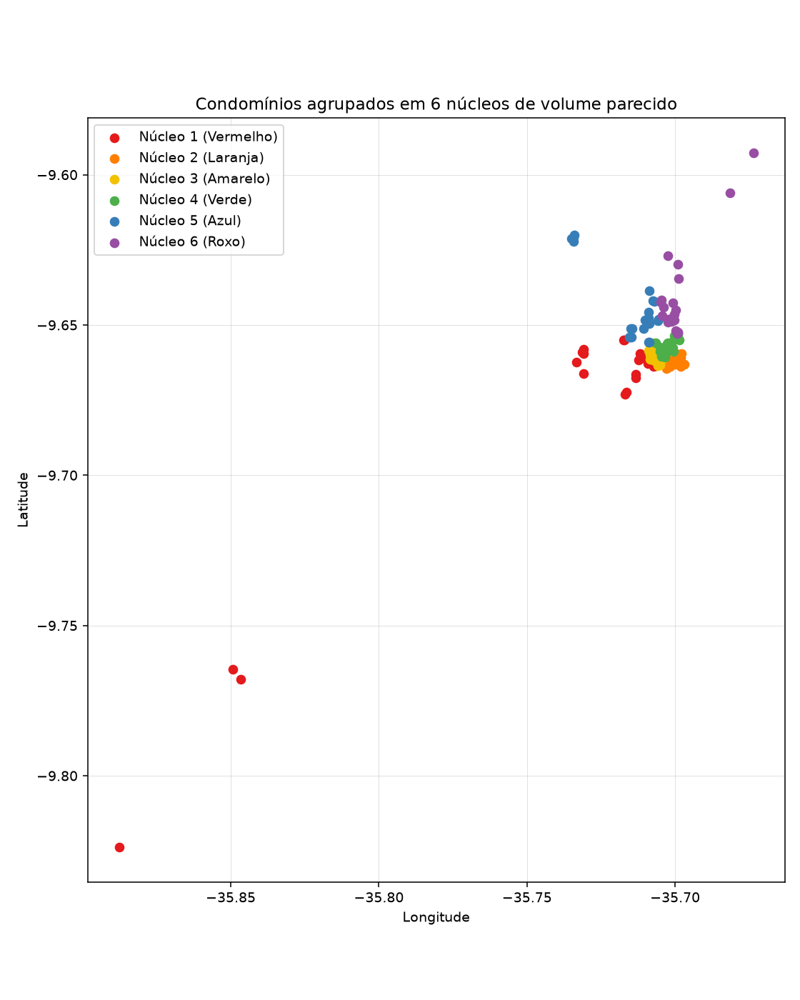

# K-Means Geographic Clustering

Agrupamento geográfico dos condomínios de uma rota operacional no litoral de Maceió e na Praia do Francês, formando núcleos de proximidade com volume parecido.


## Overview

Projeto focado na construção de um agrupamento com **Python** e **Scikit-learn**, cobrindo geocodificação, projeção local e **K-Means** com restrição de capacidade. O objetivo é formar **6 núcleos** pela proximidade, com um volume próximo de condomínios em cada grupo.


## Mapa

[](https://htmlpreview.github.io/?https://github.com/matheuseduardolr/machine_learning/blob/main/project_clustering_kmeans/images/nucleos_mapa.html)

[Abrir mapa interativo](https://htmlpreview.github.io/?https://github.com/matheuseduardolr/machine_learning/blob/main/project_clustering_kmeans/images/nucleos_mapa.html)


## Tech Stack

* Python 3.12  
* Pandas, NumPy  
* Scikit-learn (KMeans)  
* SciPy (atribuição com capacidade)  
* Matplotlib, Folium  
* GeoPy, OpenPyXL  


## Estrutura do Projeto

```text
.
├── data/                  # planilha e cache de geocodificação
├── images/                # gráfico e mapa dos núcleos
├── notebooks/             # estudo do K-Means
└── src/project_clustering_kmeans/
    ├── geocoding.py       # endereço → coordenada
    ├── clustering.py      # K-Means com capacidade
    ├── data.py            # leitura e gravação da planilha
    ├── visualization.py   # gráfico e mapa
    └── pipeline.py        # execução do estudo
```


## Workflow

* **Geocodificação:** nome, endereço, bairro e cidade viram latitude e longitude. Três endereços não localizados usam coordenada informada.  

* **Projeção:** latitude e longitude são convertidas para um plano local em metros, para a distância euclidiana corresponder à proximidade no mapa.  

* **K-Means:** ajuste de `KMeans(n_clusters=6, n_init=20, random_state=42)` e reatribuição de cada condomínio ao centro mais próximo, com vagas limitadas.  

* **Resultados:** núcleos numerados de sul para norte, com cor, planilha atualizada, gráfico em `images/nucleos_kmeans.png` e mapa em `images/nucleos_mapa.html`.  
